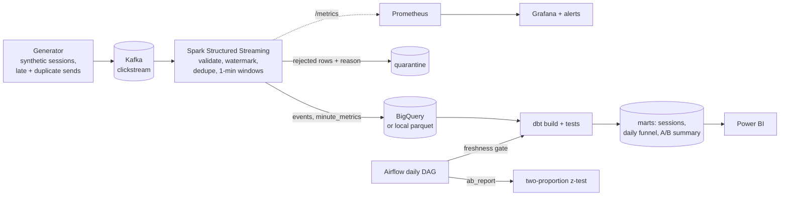

# Pulse: Streaming Clickstream Analytics

Real-time clickstream pipeline with late-event and duplicate handling,
monitoring and alerting, a daily dbt build behind a freshness gate, A/B test
analysis, and Terraform for GCP.

> Personal project. All events are synthetic (`pulse.generator`).



## What it handles

| Problem | How | Where |
|---|---|---|
| Malformed / invalid events | Rejected rows go to a `quarantine` table with a reason instead of disappearing | `src/pulse/transforms.py` `parse` |
| Client retries (duplicate sends) | `dropDuplicatesWithinWatermark(["event_id"])`; state stays bounded by the watermark | `dedupe` |
| Late events | 10-minute event-time watermark; up to 10 min late is counted in the right minute, later is dropped and counted in `pulse_rows_dropped_by_watermark_total` | `dedupe`, `minute_metrics` |
| Replayed micro-batches | `foreachBatch` is at-least-once: local sink overwrites per `batch_id`; BigQuery rows carry `_batch_id` and dbt keeps one row per `event_id` | `src/pulse/sinks.py`, `dbt/models/staging` |
| Restarts | Kafka offsets and streaming state (RocksDB) are checkpointed per query | `src/pulse/jobs/stream.py` |
| Stale inputs | Airflow fails the run before `dbt build` if the newest event is older than `PULSE_MAX_LAG_H` | `airflow/dags/pulse_daily.py` |
| Broken experiment split | Sample-ratio-mismatch check; a mismatch fails the report instead of publishing a p-value | `src/pulse/abtest.py` |

## Monitoring

The Spark driver exposes Prometheus metrics on `:8000` from a
`StreamingQueryListener`: input/processing rate, batch duration, rows in state,
rows dropped by the watermark, and Kafka offsets behind latest. (Spark does not
commit offsets to a Kafka consumer group, so consumer lag comes from the
query's own progress reports.)

Alert rules (`monitoring/alerts.yml`): stream stalled, metrics endpoint down,
Kafka lag high, late-event spike, batches slower than the trigger, query failed.
Grafana loads the "Pulse - Streaming Health" dashboard automatically.

## A/B analysis

Users are split 50/50 by a stable hash of `user_id`. Conversion is measured per
session (did it reach `purchase`). `src/pulse/abtest.py` runs a two-sided
two-proportion z-test with a confidence interval for the difference, checks
for sample ratio mismatch, and can compute the sessions needed per variant for
a given lift. Caveat stated in the code: sessions of the same user are not fully
independent.

## Run it

Requirements: Docker, Python 3.11+, Java 17.

```bash
python -m venv .venv && source .venv/bin/activate
make install
make up            # Kafka, Prometheus (:9090), Grafana (:3000), Airflow (:8080)
make stream        # terminal 1: Spark job, metrics on :8000
make generate      # terminal 2: 20 sessions/s for 10 minutes
make gold          # dbt build + tests on the landed data
make report        # A/B significance test
```

No Docker? `make dbt-fixture` writes a synthetic raw layer (including a replayed
batch) and runs the full dbt build and tests on it.

### GCP (optional)

```bash
cd infra/gcp
terraform init
terraform apply -var="project_id=<your-project>"
gcloud auth application-default login
python -m pulse.jobs.stream --sink bigquery --project <your-project> --dataset pulse_raw
cd ../../dbt && GCP_PROJECT=<your-project> dbt build --profiles-dir . --target bigquery
terraform -chdir=../infra/gcp destroy -var="project_id=<your-project>"   # stop charges
```

Terraform creates the GCS bucket (public access blocked, lifecycle expiry), the
`pulse_raw` and `pulse_analytics` datasets, and a `pulse-pipeline` service
account with dataset-scoped `dataEditor`, project `jobUser` and bucket
`objectAdmin` only. No service-account key is created.

## Tests

| Suite | What it checks |
|---|---|
| pytest | event contract, generator (stable assignment, injected late/duplicate events, funnel order), A/B statistics against hand-computed values, SRM detection, metrics extraction |
| pytest + Spark | quarantine reasons; duplicates and events behind the watermark are dropped across micro-batches; minute windows are emitted only after the watermark passes |
| pytest + Airflow | DAG imports cleanly, task order, retries |
| dbt | uniqueness after replay, accepted values, funnel monotonicity (warning), sessions never mix variants, revenue reconciles to purchase events |

CI runs lint, pytest with Spark, `dbt build` on the fixture, the Airflow DAG
test, and `terraform validate` on every push and pull request.

## Results

Fill in from your own runs:

| Metric | Value | Conditions |
|---|---|---|
| Sustained events/s through the stream job | _tbd_ | generator rate, machine, run length |
| Median micro-batch duration | _tbd_ | from Grafana |
| Late events dropped | _tbd_ | generator late fraction |

## Known limitations

* The BigQuery sink loads via pandas per micro-batch; fine for demo volumes, a
  production job would use the Spark BigQuery connector or the Storage Write API.
* Single-node Spark and single-broker Kafka.
* Alerts are evaluated by Prometheus but not routed (no Alertmanager receivers configured).
